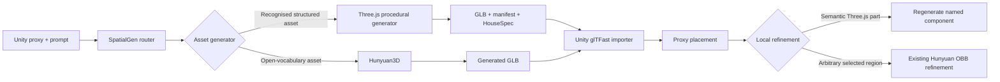

# Three.js Procedural Generation Implementation Plan

## Summary

Three.js should be added as an asset-generation provider, not as a refinement lifter. It will generate structured assets directly, while Hunyuan remains available for open-ended geometry. Procedural assets can use semantic refinement first and the existing oriented-bounding-box (OBB) clipping pipeline as a fallback.



## 1. Provider and interface changes

Replace the misleading `GenerationModel` concept with an asset generator:

```csharp
public enum AssetGenerator
{
    Hunyuan3D21 = 0,
    TripoSR = 1,
    ThreeJSProcedural = 2,
    Auto = 3
}
```

Preserve the existing serialized values and migrate the field with `FormerlySerializedAs`.

`Auto` will:

- Use Three.js for recognised structured classes such as houses.
- Use Hunyuan3D for unsupported or organic subjects.
- Report the chosen provider instead of silently switching.

Add an optional per-proxy override:

```csharp
public enum AssetGeneratorOverride
{
    Inherit,
    ThreeJSProcedural,
    Hunyuan3D21,
    TripoSR
}
```

The Unity window should show:

- **Asset Generator:** Auto, Three.js Procedural, Hunyuan3D, or TripoSR.
- **Region Refinement Lifter:** Hunyuan3D-2MV or TripoSR.

Three.js should not appear in the refinement-lifter list because it does not lift images.

Primary files:

- [`BackendSettings.cs`](../Assets/SpatialGeneration/RunTime/Generation/Backends/BackendSettings.cs)
- [`SpatialProxy.cs`](../Assets/SpatialGeneration/RunTime/SpatialProxies/SpatialProxy.cs)
- [`SpatialGenerationWindow.cs`](../Assets/SpatialGeneration/Editor/UI/SpatialGenerationWindow.cs)

## 2. Define a validated procedural specification

Introduce a versioned `HouseSpec`:

```json
{
  "version": 1,
  "assetType": "house",
  "dimensionsMeters": {
    "width": 8,
    "height": 6,
    "depth": 5
  },
  "storeys": 2,
  "roof": {
    "type": "gable",
    "pitchDegrees": 35,
    "overhang": 0.25
  },
  "doors": [],
  "windows": [],
  "style": {
    "geometry": "low-poly",
    "wallColor": "#d8c3a5",
    "roofColor": "#784b38"
  },
  "seed": 1234
}
```

Rules:

- Overall dimensions always come from the Unity proxy.
- The text prompt controls structure and appearance, not placement or scale.
- Missing properties receive deterministic defaults.
- Invalid combinations are corrected or rejected before geometry generation.
- The resolved specification is saved beside every GLB for reproducibility.

For the first version, use a deterministic parser supporting terms such as:

- one-storey or two-storey;
- gable, hip, or flat roof;
- roof pitch and overhang;
- door and window count;
- symmetric or asymmetric facade;
- low-poly colour and material choices.

Unsupported subjects in `Auto` mode go to Hunyuan. A future language-model parser can generate the same validated `HouseSpec` without changing the geometry generator.

## 3. Add the headless Three.js generator

Create:

```text
tools/threejs_generator/
├── package.json
├── package-lock.json
├── tsconfig.json
├── src/
│   ├── cli.ts
│   ├── house-spec.ts
│   ├── prompt-parser.ts
│   ├── generate-house.ts
│   ├── geometry/
│   │   ├── walls.ts
│   │   ├── roof.ts
│   │   ├── openings.ts
│   │   └── primitives.ts
│   ├── validate-mesh.ts
│   ├── export-glb.ts
│   └── manifest.ts
└── tests/
```

This runs in Node without a browser or WebGL renderer.

Geometry requirements:

- Use indexed `BufferGeometry`.
- Generate explicit triangles rather than background planes.
- Use consistent winding and finite coordinates.
- Reject zero-area triangles.
- Give every component a stable semantic name.
- Generate normals and UVs.
- Use metre-based dimensions and standard glTF Y-up coordinates.
- Keep the model centred on a predictable origin.
- Export one scene root without cameras, lights, floors, scenery, or background objects.

Suggested hierarchy:

```text
House
├── Structure
│   ├── Wall_Front
│   ├── Wall_Back
│   ├── Wall_Left
│   └── Wall_Right
├── Roof
│   ├── Roof_Left
│   └── Roof_Right
├── Openings
│   ├── Door_Front_01
│   ├── Window_Front_01
│   └── Window_Front_02
└── Foundation
```

Use `GLTFExporter` with a small Node-compatible file-reader adapter. Validate every result with Khronos `gltf-validator`.

## 4. Add a generation manifest

Export `house.glb` and `house.manifest.json` together:

```json
{
  "provider": "threejs_procedural",
  "assetType": "house",
  "specVersion": 1,
  "units": "meters",
  "upAxis": [0, 1, 0],
  "frontAxis": [0, 0, 1],
  "bounds": {
    "size": [8, 6, 5]
  },
  "parts": [
    {
      "id": "Window_Front_01",
      "category": "window",
      "bounds": {}
    }
  ]
}
```

The sidecar manifest is authoritative because Unity importers do not always expose arbitrary glTF extras consistently.

Extend `GeneratedMeshMetadata` with:

- `generatorUsed`
- `assetType`
- `specPath`
- `manifestPath`
- `canonicalForward`
- `specVersion`

## 5. Integrate it into the router

Three.js generation should still pass through the existing router so local and Colab modes share one API.

Add a router-native generation job system:

- `procedural_jobs.py`: asynchronous job registry.
- `procedural_generator.py`: invokes Node with an argument array, never through a shell.
- Confine input and output paths to a dedicated job directory.
- Pass the request as JSON.
- Return both GLB and manifest through the existing `/result` and `/view` endpoints.

Extend `/health`:

```json
{
  "generation_generators": [
    {
      "id": "threejs_procedural",
      "available": true,
      "detail": ""
    }
  ]
}
```

Three.js generation must not require ComfyUI. Therefore, [`RouterGenerationBackend.cs`](../Assets/SpatialGeneration/RunTime/Generation/Backends/RouterGenerationBackend.cs) should:

- Check only the router and Node capability for Three.js.
- Avoid opening ComfyUI when Three.js is selected.
- Continue using the existing ComfyUI readiness path for Hunyuan and TripoSR.

## 6. Correct Unity placement

Add `generator_used`, warnings, and manifest information to the result protocol.

In [`GenerationRunner.cs`](../Assets/SpatialGeneration/Editor/Tools/GenerationRunner.cs):

- Hunyuan and TripoSR retain levelling and volume fitting.
- Three.js skips heuristic `MeshAlignment.Level`.
- Apply a tested fixed conversion from canonical glTF front to proxy front.
- Position the asset at the proxy centre.
- Verify imported bounds against the manifest.
- Apply corrective scaling only if the imported dimensions differ by more than approximately 1%.

Use an asymmetric calibration house—door on the front-left and chimney on the rear-right—to verify orientation through the complete Three.js → GLB → glTFast → Unity path.

## 7. Add semantic local refinement

When the selected asset has `generatorUsed == "threejs_procedural"`:

1. Transform the OBB selection into the asset's local coordinates.
2. Find semantic parts whose bounds intersect the region.
3. Submit the original `HouseSpec`, selected part IDs, selection bounds, and refinement prompt.
4. Convert supported prompts into a validated specification patch.
5. Regenerate the affected components.
6. Import the temporary result.
7. Replace only components whose semantic IDs changed.
8. Preserve all untouched Unity meshes and transforms exactly.
9. Commit the replacement as one Undo operation.

Initially supported changes should include:

- changing roof type, pitch, overhang, or colour;
- resizing or restyling a selected window;
- adding or removing a window;
- resizing or replacing a door;
- changing facade material or colour;
- adding simple components such as a chimney or dormer.

If the prompt or selected geometry cannot be represented procedurally, explicitly fall back to the existing Hunyuan OBB clipping and welding path.

Add a new `ProceduralRefinementApplier.cs` rather than embedding this logic in [`RefinementMeshLoader.cs`](../Assets/SpatialGeneration/Editor/Tools/RefinementMeshLoader.cs).

## 8. Colab and setup

Add:

```text
tools/setup_threejs.sh
```

It should:

- verify Node and npm;
- install the locked dependencies;
- run a calibration generation;
- validate the resulting GLB;
- print an actionable error if setup fails.

Update [`Colab_ComfyUI.ipynb`](../notebooks/Colab_ComfyUI.ipynb) to install the same locked dependencies and run one procedural capability smoke test. No ComfyUI model or GPU is required for this branch.

## 9. Test plan

### Node tests

- Deterministic prompt-to-spec conversion.
- Exact proxy dimensions.
- Unique semantic IDs.
- Valid indices and attributes.
- No non-finite or zero-area triangles.
- Valid glTF output.
- Stable geometry for an identical specification and seed.

### Router tests

- Three.js capability reporting.
- Generation without ComfyUI.
- `Auto` routing and Hunyuan fallback.
- Safe job-file access.
- GLB and manifest collection.
- Useful errors for unsupported specifications.

### Unity tests

- Correct imported orientation.
- Bounds within 1% of the proxy.
- Metadata and manifest association.
- No levelling applied to procedural assets.
- Semantic part selection from a rotated OBB.
- Replacement of only selected components.
- Failed refinement leaves the original unchanged.
- Undo and Redo restore the complete hierarchy.

### End-to-end acceptance cases

- "Small two-storey house with a gabled roof" produces an upright, complete house without scenery.
- Generation completes in seconds and does not launch ComfyUI.
- The imported asset matches proxy dimensions within 1%.
- "Make this window twice as wide" changes only the selected window.
- "Change the roof to a hip roof" changes only roof components.
- Unsupported requests fall back to Hunyuan with a visible warning.
- Every generated GLB passes the glTF validator without errors.

## Recommended delivery order

1. HouseSpec, generator, GLB export, and validation.
2. Router-native procedural jobs and health reporting.
3. Unity provider selection, import, orientation, and metadata.
4. Auto routing and per-proxy overrides.
5. Semantic roof, door, and window refinement.
6. Hunyuan fallback integration.
7. Colab setup and complete end-to-end tests.

This sequence produces a useful procedural house generator after step 3, while semantic local refinement can be added without destabilizing the current Hunyuan workflow.
